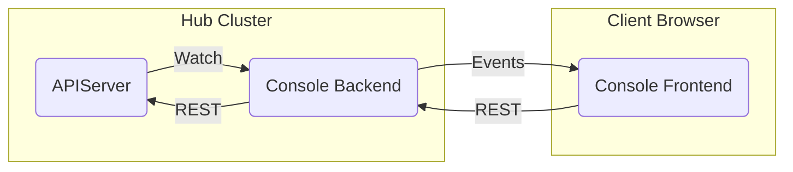

[comment]: # ( Copyright Contributors to the Open Cluster Management project )

# Console Architecture

## Console Frontend

The console frontend is a static single page application.
Resources from the backend are automatically stored and updated globally in shared atoms.
All data is stored in memory.
All calls from the frontend to work with resources should use the resource utility functions. i.e. `createResource()`.
The frontend should use PatternFly components without modifying the look and feel of the controls using CSS.

The frontend has two builds. One for the stand alone version and one for the dynamic plugin version that is dynamically loaded into the OCP Console.

### ApplicationSet repository analysis

Git repository nodes start green and are analyzed asynchronously before GitOps and deployment analysis. Their status decorator shows a spinner while analysis is pending, including during refresh; other node statuses remain visible until analysis finishes. The navigator and analysis share the loader in [repositoryUtils.ts](../frontend/src/resources/repositoryUtils.ts). GitHub sources are supported; Helm chart nodes retain their existing behavior.

Analysis reads YAML files root-first, up to three directory levels and ten files per repository node. The limits are defined by `REPOSITORY_YAML_MAX_DEPTH` and `REPOSITORY_YAML_MAX_FILES`. Template expressions are masked without changing source positions, and checks requiring unresolved values are skipped. Syntax errors stop further checks for that file. All scalar fields whose names contain `port` must be integers from 0 through 32767. AnsibleJob checks use the referenced namespace's hub credential and the existing Ansible backend API to verify connectivity and job template names.

Repository errors turn the node red, suppress other node statuses, and stop subsequent analysis. Errors are consolidated into one alert, grouped by file within each repository source, with sorted, unique line numbers and deduplicated messages and suggestions. The alert shows up to five entries, followed by "And more..." when additional entries exist. All errors retain source, file, and line identifiers for navigator icons and SyncEditor diagnostics. Empty sources and access failures are distinguished. The navigator still displays the complete file tree; the analysis limits do not restrict browsing.

The read-only repository editor preserves the original YAML text, including object order, comments, blank lines, and document separators, so diagnostic markers use the same source line numbers as analysis. Source preservation is opt-in and does not bypass secret redaction or filtering in other SyncEditor views.

## Console Backend

The public listener is a Go process (`backend/`). Hub kube-apiserver passthrough routes (`/api`, `/apis`, `/version`), managed-cluster, metrics, VirtualMachine proxy, Search proxy, and long-tail HTTP (ROSA wizard, Ansible Tower, placement-debug, upgrade-risks) are served natively in Go. The plugin and browser keep talking to the same Service and paths.

The console backend uses a service account to `list` and `watch` kubernetes cluster resources.
Resource events are streamed to the console frontend.
RBAC is enforced using the token passed from the console frontend.
All resources are checked for access using `SubjectAccessReview` calls to the cluster.

The console backend proxies the cluster apiserver `/api` and `/apis` apiserver REST routes from the Go public listener (`backend/internal/k8sproxy`).
All REST calls use the token passed from the console frontend.

Standalone login (`GET /login`, `/login/callback`, `/logout`) is served by the Go listener in non-production. `GET /configure` returns `{ token_endpoint }` from OAuth/OIDC discovery for frontend logout and the Display Token page. The cookie `acm-access-token-cookie` (HttpOnly, Path=/, Secure in production) holds the OpenShift access token or OIDC id_token. Production plugin mode continues to use OpenShift Console authentication.

The Go listener runs a client-go informer cache (`backend/internal/informers`) from `DefaultWatchSpecs()` in `backend/internal/informers/specs.go`. `GET /events` is served by Go (`backend/internal/events/hub`) with per-user RBAC: cluster `list` SSAR, then SelfSubjectRulesReview, then SSAR fallback (60s cache). `POST /aggregate/{applications,statuses,appSetData}` is served by Go (`backend/internal/aggregate`) from that cache plus an in-cluster Search GraphQL client (service-account token). `POST /proxy/search` and the Search graphql-ws relay are served by Go (`backend/internal/searchproxy`) with the user token. ROSA wizard, `POST /ansibletower`, `POST /placement-debug`, and `POST /upgrade-risks-prediction` are served by Go (`backend/internal/rosa`, `ansibletower`, `placementdebug`, `upgraderisks`). The Go store holds `unstructured.Unstructured` (managedFields stripped except Policy). Development builds expose `GET /debug/informer-snapshot`. `GET /events/rbac` remains a separate ClusterRole informer.

TLS on the public Go listener (`backend/internal/tlsconfig`) follows the hub `APIServer` `tlsSecurityProfile` (Old / Intermediate / Modern / Custom) and reloads `certs/tls.crt` + `tls.key` without restarting the process. Existing connections keep their handshake; new connections use the updated config.

DELETED resource events are sent to every SSE client without an access check. That is a known quirk to fix later.

Static plugin assets (`plugin-manifest.json`, `plugin-entry.js`, hashed JS/CSS, locales) are served by the Go listener with cache headers, CSP, and brotli/gzip content negotiation.
